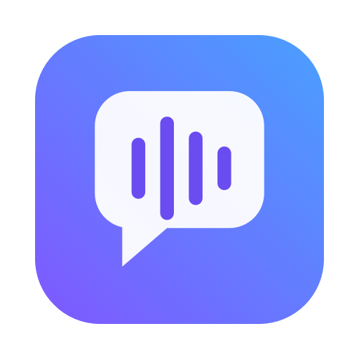
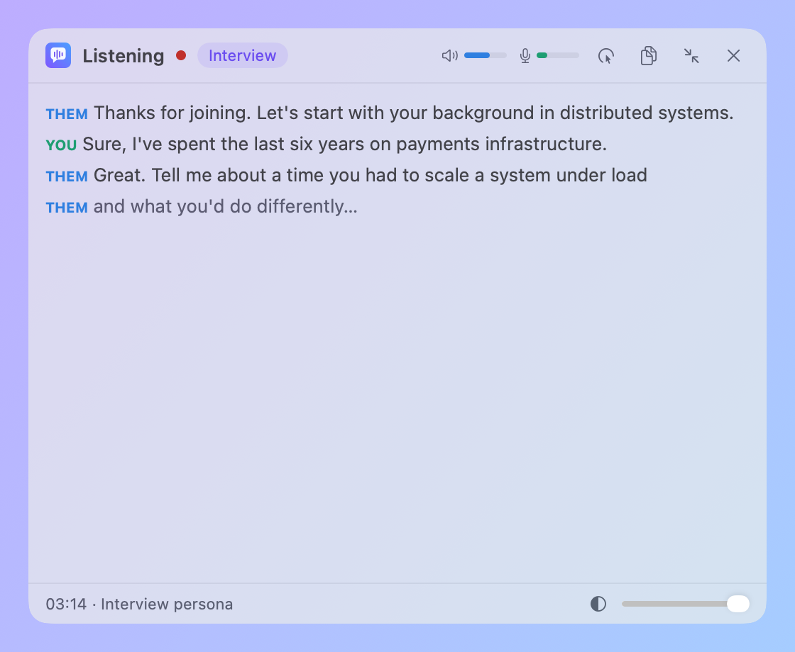
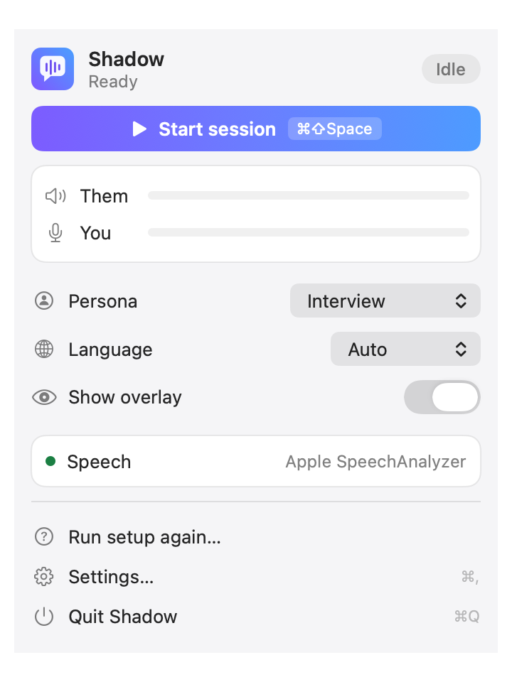
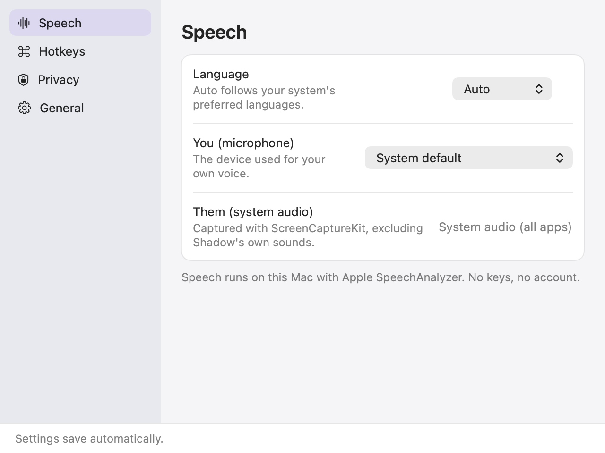

<p align="center"></p>

<h1 align="center">Shadow</h1>

<p align="center">A free, open-source, on-device live transcript for meetings and interviews. macOS 26+ menu bar app.</p>

<p align="center"></p>

## Install with an AI agent

Paste this into an AI coding agent such as Claude Code. Shadow has no release build yet, so the agent builds it from source (Xcode with the macOS 26 SDK is required):

```text
Install Shadow on this Mac.
1. Run: git clone https://github.com/kalahroudi/shadow.git && cd shadow && scripts/bundle.sh
2. Copy dist/Shadow.app to /Applications and open it. Its first-run setup asks for Screen & System Audio Recording and
   Microphone permission. Tell me to click through that window if it is waiting, and wait until it is done.
   If macOS says a relaunch is needed after screen recording is granted, quit and reopen Shadow.
3. Register its MCP server: claude mcp add shadow --scope user -- /Applications/Shadow.app/Contents/MacOS/shadow-mcp
4. Call get_status and tell me what it reports.
Never call a destructive tool without asking me first.
```

## Features

- **Two separate streams.** Them is system audio (ScreenCaptureKit, excluding Shadow's own sounds). You is your microphone. Pick the microphone in Settings > Speech (it takes effect on the next Start). Capturing a single app or window for Them is a planned follow-up; for now Them is whole system audio.
- **On-device speech-to-text.** Apple SpeechAnalyzer, no keys, no account, no cloud.
- **Live floating overlay.** Frosted glass, follows you across Spaces, never steals focus. Compact and Expanded, adjustable opacity, per-display position, optional click-through with a hotkey that always turns it off.
- **Menu bar popover.** Start/Stop, level meters, persona and language pickers, overlay switch.
- **Global hotkeys.** ⌘⇧Space start/stop, ⌘⇧H show/hide, ⌘⇧T click-through, ⌘⇧E compact/expand. All rebindable in Settings, no extra permission.
- **Settings.** Speech, Hotkeys, Privacy and General panes. Every option saves and applies immediately.
- **Visible by design.** No stealth mode and no way to hide the overlay from screen sharing. A reminder before each session is on by default.
- **Private.** Audio is never written to disk. Only the text transcript is saved, under `~/Library/Application Support/Shadow/sessions/`, written atomically, with recovery after a crash.

<p align="center"> </p>

## Status

Milestone 1 (capture, live transcript, overlay) is in development. The app builds and tests with zero warnings, and unit tests drive the whole session pipeline with fakes. Hardware paths (ScreenCaptureKit, microphone, SpeechAnalyzer) need manual checks on a real Mac. Builds are unsigned.

## Roadmap

Next milestones:

- LLM answers (the Answering state is a stub today)
- Screenshots and OCR
- RAG over your own files
- History
- Sparkle updates
- Notarization, DMG and Homebrew cask

## Build

```sh
swift build && swift test      # zero warnings expected
scripts/bundle.sh              # dist/Shadow.app
dist/Shadow.app/Contents/MacOS/Shadow --self-test   # prints ok
dist/Shadow.app/Contents/MacOS/Shadow --snapshot /tmp/shots   # sample-data screenshots
```

## License

Apache-2.0
